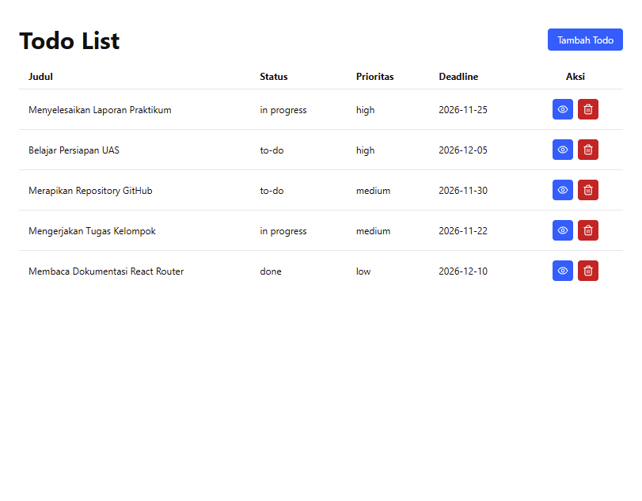
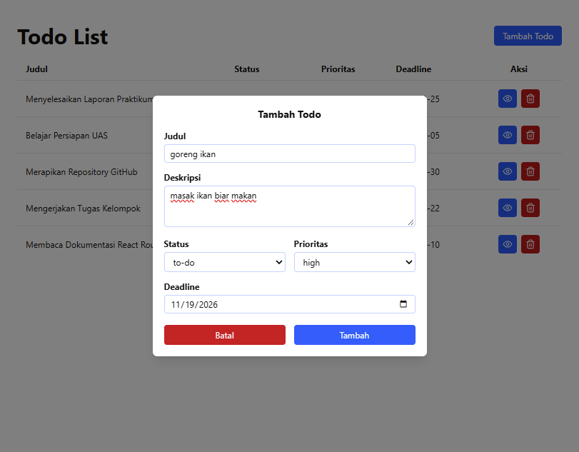
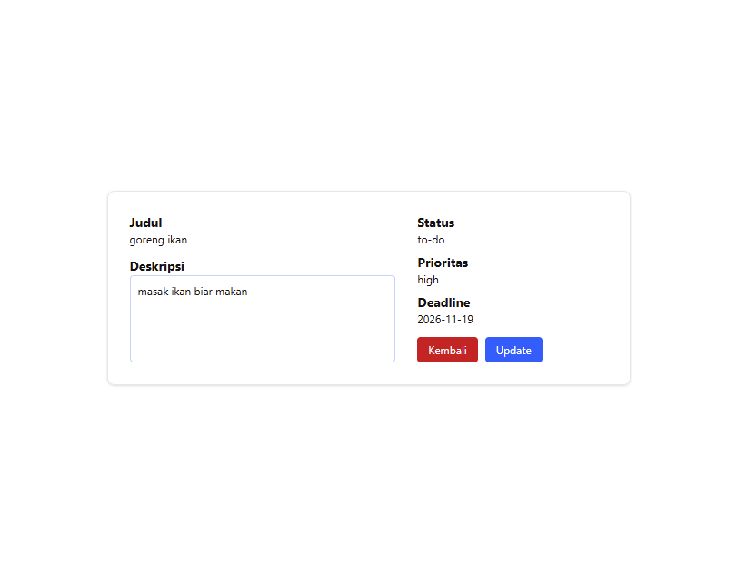
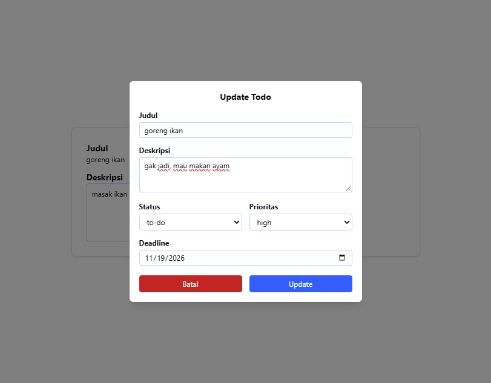
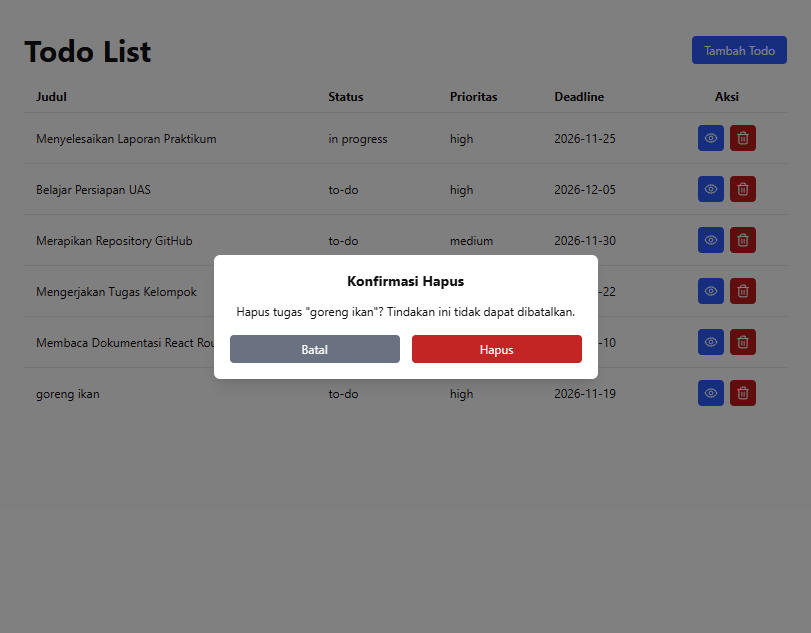

# Todo List – React.js

Aplikasi To-Do List frontend (React + Vite + Tailwind CSS) dengan data dummy.
Fitur: lihat daftar, lihat detail, tambah, update, dan hapus tugas (dengan konfirmasi + notifikasi).

## Struktur data
```js
{ id, title, description, priority, deadline, status }
```

## Menjalankan
```bash
npm install
npm run dev
```
Buka http://localhost:5173

## Screenshot
> Ganti dengan screenshot hasil aplikasi kamu (simpan di folder `screenshots/`).

| Halaman | Screenshot |
|---|---|
| Daftar Todo |  |
| Tambah Todo |  |
| Detail Todo |  |
| Update Todo |  |
| Konfirmasi Hapus |  |
